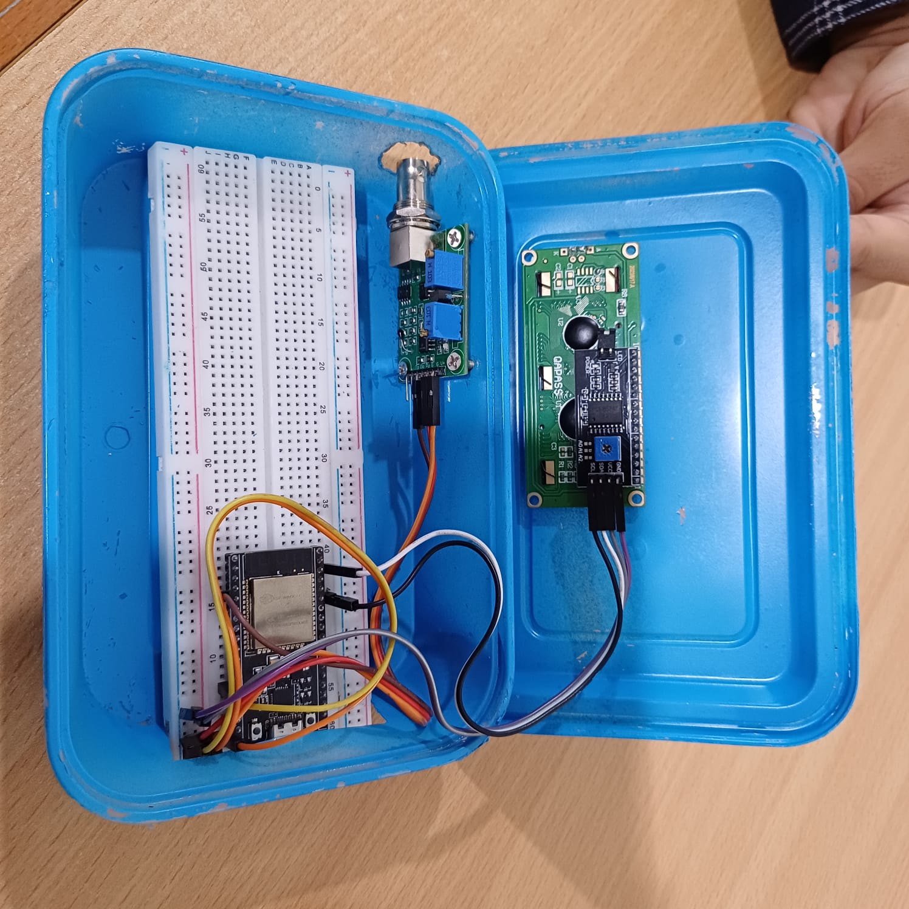
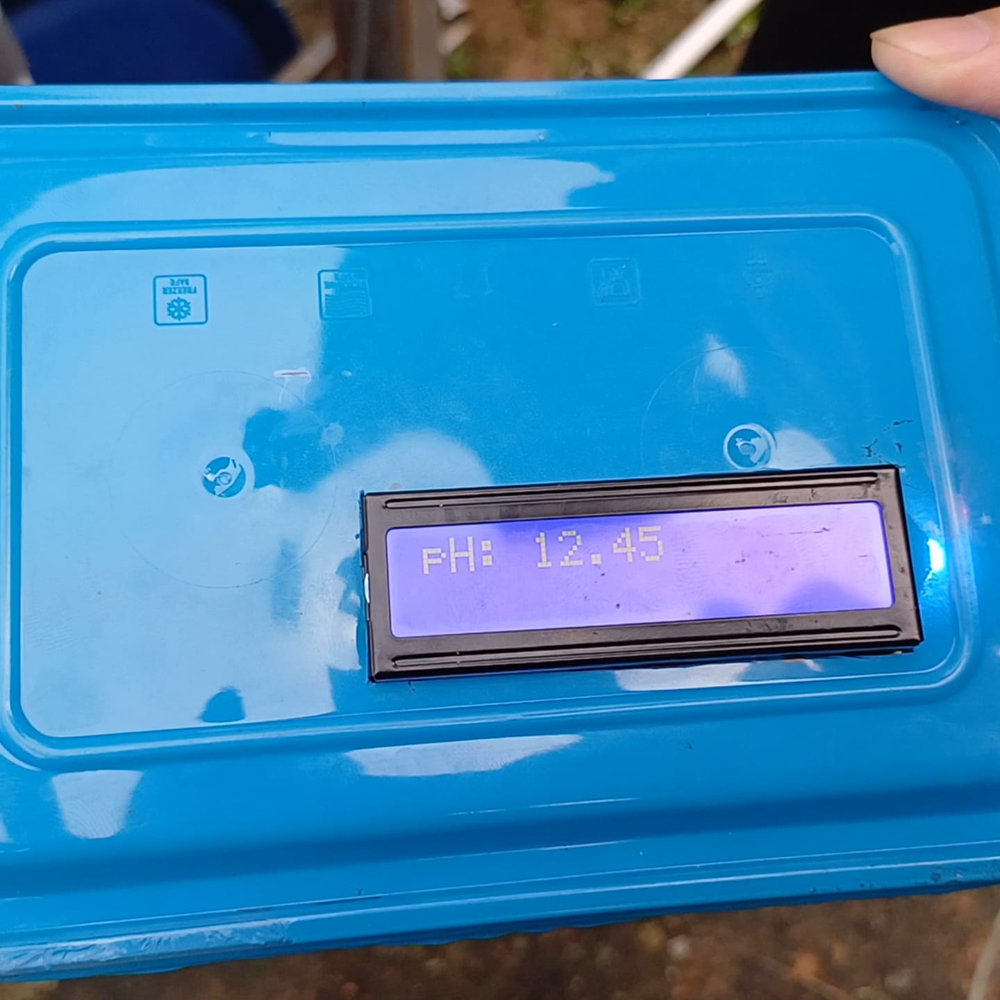
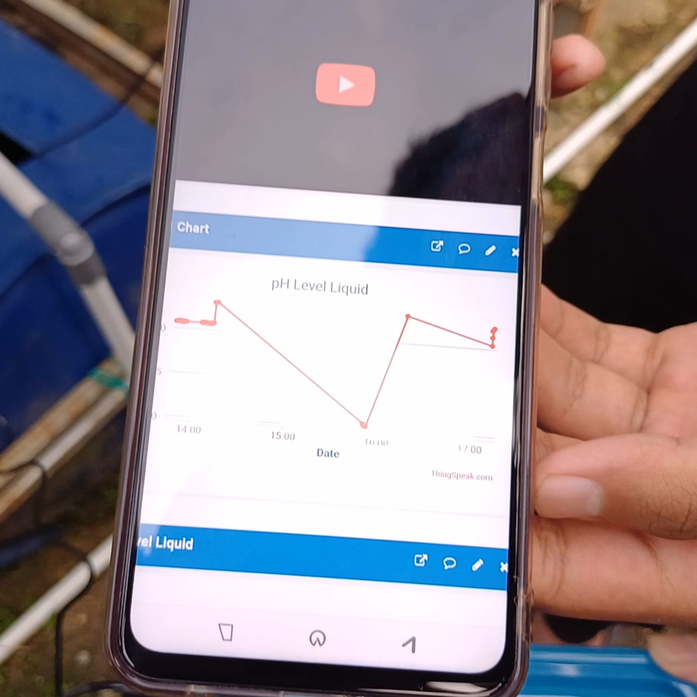
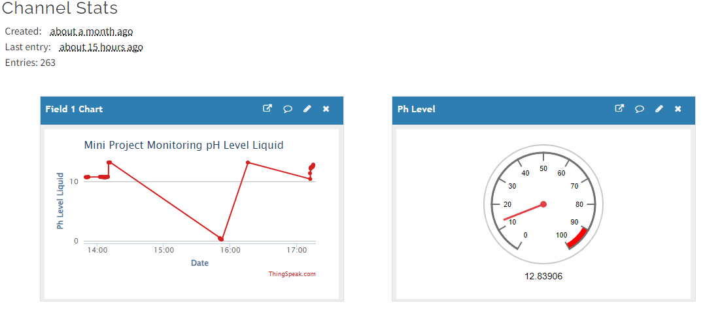

# IoT pH Monitoring System

An ESP32-based prototype for measuring pH and displaying the readings locally and through a ThingSpeak dashboard.

> **Project type:** Team project

## Overview

The system reads a pH sensor through a 4502C analog module, displays the value locally, and sends monitoring data to ThingSpeak for remote observation.

## My Contribution

- Assembled the hardware
- Programmed the ESP32 system
- Integrated the sensor, display, and IoT monitoring workflow
- Supported calibration and functional testing

## Technology

- ESP32 Dev Module
- Arduino IDE / C++
- 4502C analog pH module
- E-201 pH electrode
- Local LCD display
- ThingSpeak

## Result

Calibration produced a measurement error of **less than 5%**.

## Project Documentation

### Local Display

Local LCD showing the measured pH value.

### Mobile Monitoring

ThingSpeak monitoring interface viewed on a mobile device.

### ThingSpeak Dashboard

Remote chart and gauge visualization for the pH measurement.

## Project Status

Hardware integration, programming, calibration, and monitoring tests were completed.
